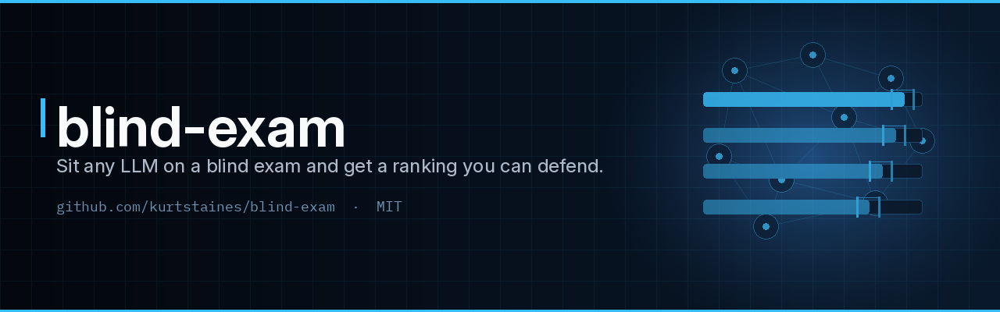
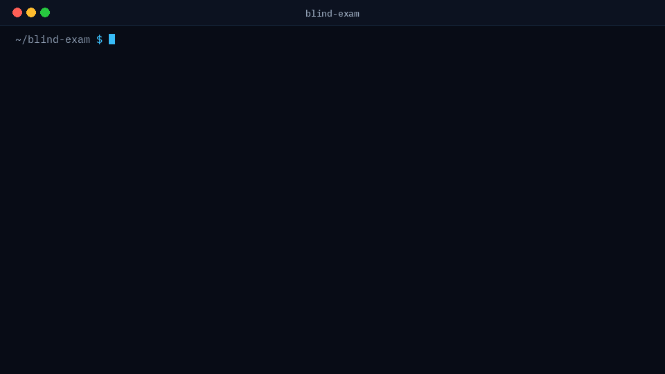
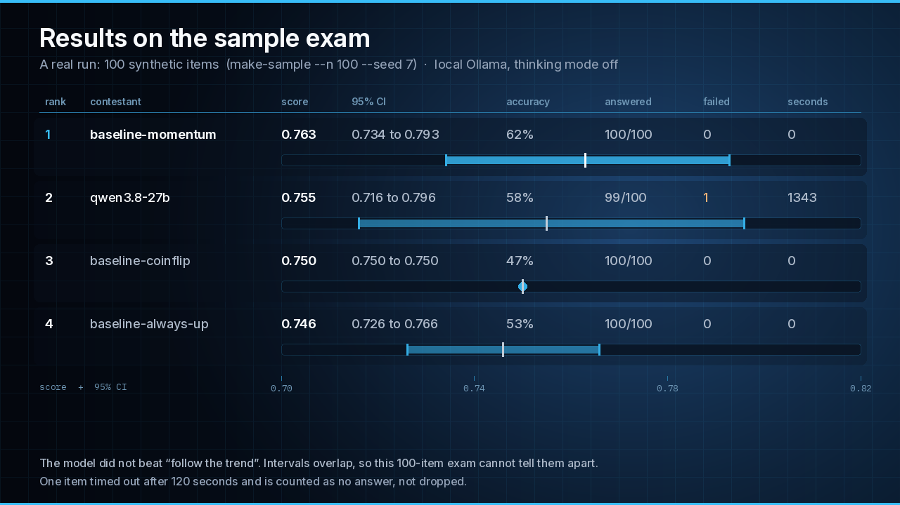
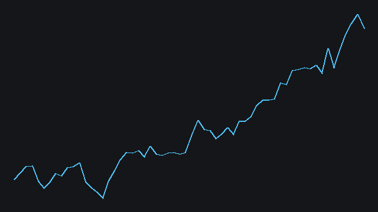
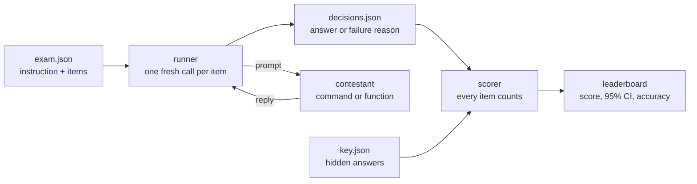

# blind-exam



[](https://github.com/kurtstaines/blind-exam/actions/workflows/ci.yml)
[](https://github.com/kurtstaines/blind-exam/blob/main/LICENSE)


**Sit any LLM on a blind exam and get a ranking you can defend.**



*A real run of the default 40-item sample exam (seed 7): the three built-in baselines, then the leaderboard with 95% intervals.*



*A real run of the 100-item sample exam: qwen3.8-27b did not beat the momentum baseline; the 95% intervals overlap.*

Most quick model comparisons leak. The model sees earlier questions, a crashed item silently
drops out of the average, and "70% accurate" hides whether the model knew when it was guessing.
`blind-exam` is a small harness that closes those three holes:

- **Blind:** one fresh call per item, so a contestant has no memory of other items and never
  sees the answer key.
- **Resumable:** every decision is saved as it lands. Timeouts and unparseable replies are
  recorded with a reason and can be retried on their own.
- **Calibrated:** scores reward knowing what you don't know, and every item counts, so skipping
  the hard ones cannot raise a score.

Status: **v0.1, early.** About 530 lines of Python with one dependency (Pillow, for the sample
exam's images).

## Results on the sample exam

A real run: 100 synthetic items (`make-sample --n 100 --seed 7`), three built-in baselines, and
one local model through Ollama with its thinking mode off.

| rank | contestant | score | 95% CI | accuracy | answered | failed | seconds |
|---|---|---|---|---|---|---|---|
| 1 | baseline-momentum | 0.763 | 0.734 to 0.793 | 62% | 100/100 | 0 | 0 |
| 2 | qwen3.8-27b | 0.755 | 0.716 to 0.796 | 58% | 99/100 | 1 | 1343 |
| 3 | baseline-coinflip | 0.750 | 0.750 to 0.750 | 47% | 100/100 | 0 | 0 |
| 4 | baseline-always-up | 0.746 | 0.726 to 0.766 | 53% | 100/100 | 0 | 0 |

What this says, and what it doesn't:

- **The model did not beat "follow the trend".** Its interval overlaps the momentum baseline's
  and the coin flip's, so on 100 items this exam cannot tell them apart. That is the honest
  reading, and it is the reason the harness prints intervals instead of a bare ranking.
- **One item timed out** after 120 seconds. It is counted as "no answer" rather than dropped, so
  the model's score includes it.
- **Always answering "up" scores below a coin flip** even though it is right 53% of the time,
  because it claims confidence it has not earned.



*One item as a contestant sees it: no axes, no labels, and the continuation hidden.*

## Quickstart

```bash
git clone https://github.com/kurtstaines/blind-exam.git
cd blind-exam
pip install -e .
blind-exam make-sample exam/
blind-exam run exam/ baseline:momentum
blind-exam board exam/
```

The package is not on PyPI. Install it from this repository with the commands above, or with `pip install "git+https://github.com/kurtstaines/blind-exam.git"`.

`board` scores every run under `exam/runs/` and writes `LEADERBOARD.md` and `leaderboard.html`
there.

## Sit a real model

A contestant is any command that reads a prompt on stdin and prints a reply. Each item starts a
new process.

```bash
blind-exam run exam/ "cmd:ollama run qwen3.8:27b-q4_K_M --think=false" --slug qwen3.8-27b
blind-exam status exam/
blind-exam run exam/ "cmd:ollama run qwen3.8:27b-q4_K_M --think=false" --slug qwen3.8-27b --retry-failed
```

Add `--workers N` to run several items at once.

Use `{image}` in the command to pass the item's image path to a vision model. The reply can
contain reasoning; the harness takes the last JSON object in it.

Or from Python, with any callable `(prompt, item) -> str`:

```python
from blind_exam import core


def my_model(prompt: str, item: dict) -> str:
    return call_my_api(prompt)


core.run_exam("exam/", my_model, "exam/runs/my-model", workers=4)
print(core.score_run("exam/", "exam/runs/my-model"))
```

## Commands

| Command | What it does |
|---|---|
| `make-sample OUT [--n 40] [--seed 7]` | Writes the reproducible synthetic sample exam. |
| `run EXAM CONTESTANT [--slug] [--limit N] [--retry-failed] [--workers N] [--timeout S]` | Sits one contestant. Skips items already answered. |
| `status EXAM` | Shows answered and failed counts per contestant, with failure reasons. |
| `board EXAM` | Scores every run against the key and writes the leaderboard. |

Contestants: `cmd:<command>`, or the built-in `baseline:coinflip`, `baseline:always-up` and
`baseline:momentum`.

## How it works



### Write your own exam

An exam is a folder with two files.

`exam.json`, which contestants see:

```json
{
  "name": "capitals",
  "instruction": "Answer with one JSON object: {\"answer\": \"<city>\"}",
  "required": ["answer"],
  "scorer": "blind_exam.scorers:exact_match",
  "items": [{"id": "q1", "text": "Capital of France?"}]
}
```

`key.json`, which they never see:

```json
{"q1": {"answer": "Paris"}}
```

A scorer is a function `(answer, key) -> {"score": float, ...}` named as `module:function`. It
receives `None` when the contestant gave nothing usable, and must still return a score.

### Scoring the sample exam

The sample items are synthetic: a drifting random walk whose trend continues into the hidden
part 70% of the time. Contestants answer `up` or `down` with a confidence from 0.5 to 1.0. The
score is `1 - (p_up - outcome)^2`:

| Answer | Score |
|---|---|
| Certain and right | 1.00 |
| "No idea" (0.5), or no usable answer | 0.75 |
| Certain and wrong | 0.00 |

The leaderboard reports the mean score with a 95% bootstrap confidence interval. When two
intervals overlap, the exam has not separated those contestants.

## Tests

```bash
pip install -e ".[dev]"
pytest
```

16 tests cover reply parsing, that a contestant never sees the key, resume and retry, parallel
runs, both scorers, the confidence interval, command contestants, sample reproducibility and the
CLI end to end. No test calls a model.

## Limits

- The sample exam measures one narrow skill on synthetic data. It shows the harness working; it
  is not a general intelligence benchmark and says nothing about real markets.
- `cmd:` contestants are only as blind as the command. A CLI that keeps its own history between
  calls would leak; check the one you use.
- Only text prompts are built in. Vision models get the image path, not the pixels.

## Roadmap

- Built-in API contestants so a hosted model needs no wrapper command
- Images attached to the prompt for vision models
- Per-item difficulty and a reliability diagram on the leaderboard page
- Paired comparison between two contestants on the same items

## Contributing

Issues and pull requests are welcome. Before opening a PR:

```bash
ruff check . && ruff format --check . && pytest
```

## License

MIT. See [LICENSE](https://github.com/kurtstaines/blind-exam/blob/main/LICENSE).
